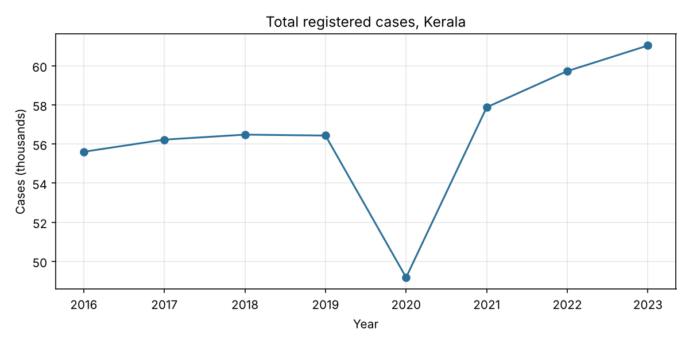
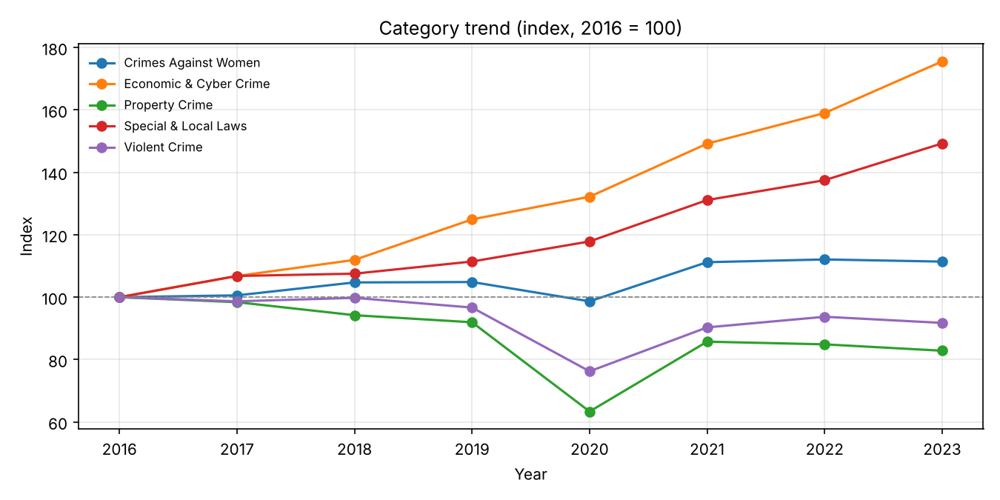
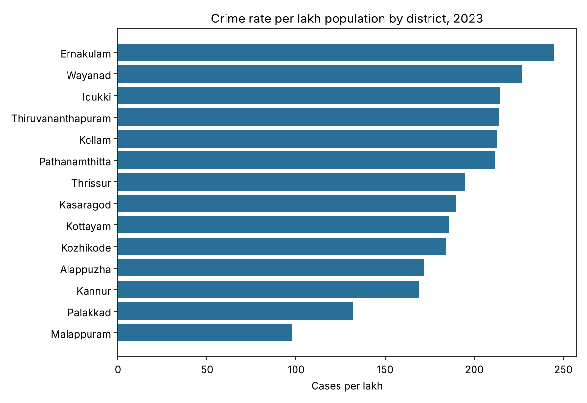
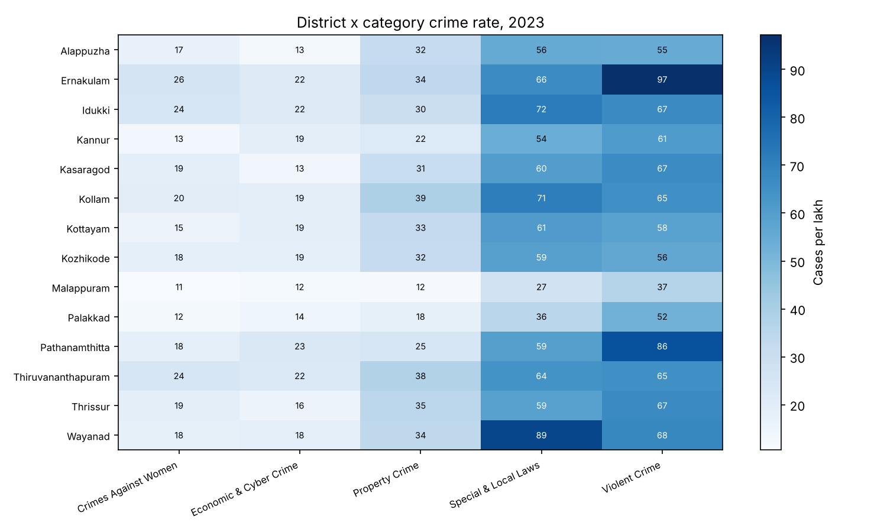
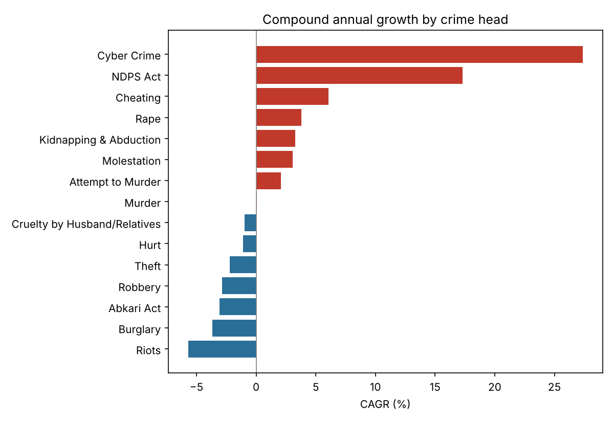

# Crime Analysis in Kerala: Findings

> **Sample data.** These findings come from the synthetic dataset made by
> `scripts/generate_sample_data.py`, so they show what the pipeline produces,
> not real facts about Kerala. Re-run with the official tables to get real findings.

Coverage: 14 districts, 15 crime heads, 2016 to 2023. Imputed cells: 3 of 1680.

## Overall trend
- Total cases went from 55,604 in 2016 to 61,036 in 2023 (CAGR +1.3%).
- The biggest year-on-year change was -12.9% in 2020.

## Category mix in 2023
- Violent Crime: 34.3% of cases
- Special & Local Laws: 30.6% of cases
- Property Crime: 15.7% of cases
- Crimes Against Women: 9.8% of cases
- Economic & Cyber Crime: 9.6% of cases

## Fastest-changing crime heads
- Cyber Crime: +27.4% a year
- NDPS Act: +17.3% a year
- Cheating: +6.1% a year
- Abkari Act: -3.1% a year
- Burglary: -3.7% a year
- Riots: -5.7% a year

## Districts by crime rate, 2023
| Rank | District | Region | Cases | Per lakh | Share of state |
|---:|---|---|---:|---:|---:|
| 1 | Ernakulam | Central | 8,038 | 245 | 13.2% |
| 2 | Wayanad | North | 1,857 | 227 | 3.0% |
| 3 | Idukki | Central | 2,377 | 214 | 3.9% |
| 4 | Thiruvananthapuram | South | 7,063 | 214 | 11.6% |
| 5 | Kollam | South | 5,616 | 213 | 9.2% |
| 6 | Pathanamthitta | South | 2,532 | 211 | 4.1% |
| 7 | Thrissur | Central | 6,082 | 195 | 10.0% |
| 8 | Kasaragod | North | 2,483 | 190 | 4.1% |
| 9 | Kottayam | Central | 3,669 | 186 | 6.0% |
| 10 | Kozhikode | North | 5,683 | 184 | 9.3% |
| 11 | Alappuzha | South | 3,658 | 172 | 6.0% |
| 12 | Kannur | North | 4,256 | 169 | 7.0% |
| 13 | Palakkad | North | 3,706 | 132 | 6.1% |
| 14 | Malappuram | North | 4,016 | 98 | 6.6% |

## Hotspots, 2023 (top 10 where the rate is at least 1.5 standard deviations above the average district)
- Ernakulam: Hurt (85.0 per lakh, z = 2.2)
- Wayanad: NDPS Act (56.9 per lakh, z = 2.2)
- Ernakulam: Murder (1.3 per lakh, z = 1.9)
- Pathanamthitta: Cheating (20.4 per lakh, z = 1.8)
- Idukki: Riots (5.7 per lakh, z = 1.8)
- Thiruvananthapuram: Murder (1.2 per lakh, z = 1.8)
- Ernakulam: Cruelty by Husband/Relatives (9.6 per lakh, z = 1.7)
- Ernakulam: Molestation (11.6 per lakh, z = 1.7)
- Ernakulam: Riots (5.6 per lakh, z = 1.7)
- Ernakulam: Kidnapping & Abduction (2.7 per lakh, z = 1.6)

## Charts

Note: rates use Census 2011 population, the latest official district count. Population growth since then pushes rates slightly upward over time.
